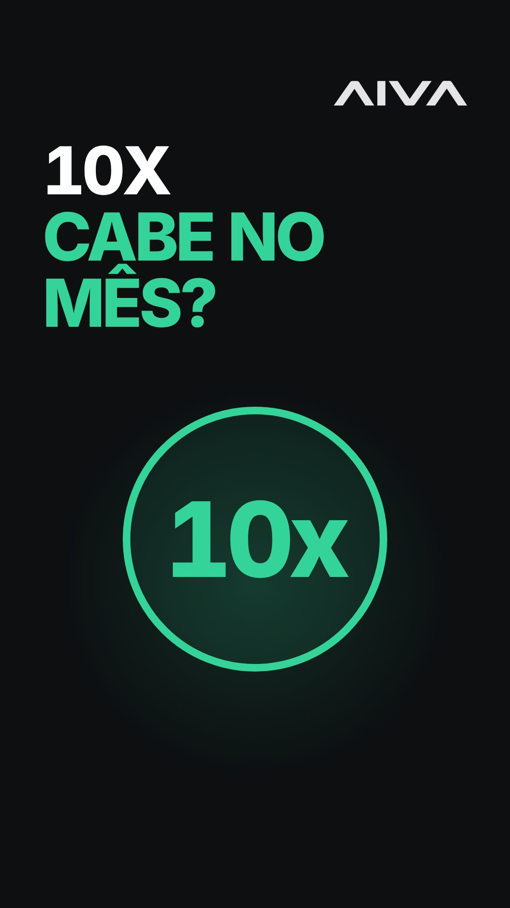
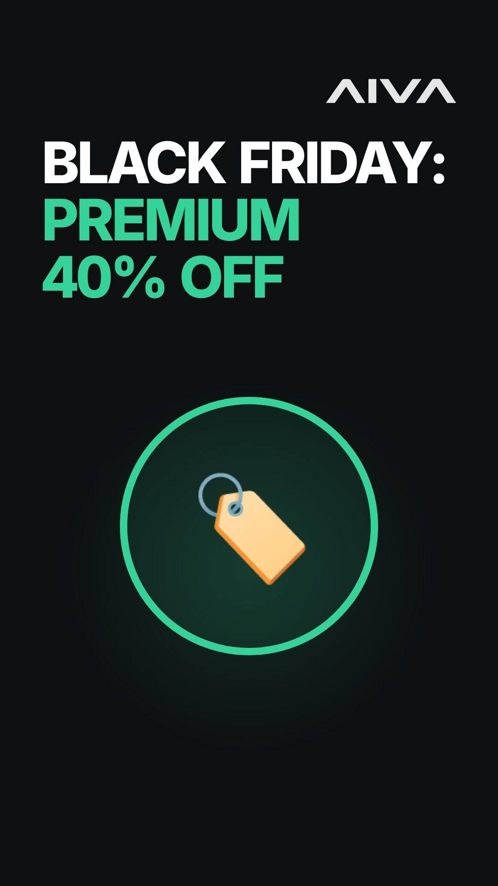
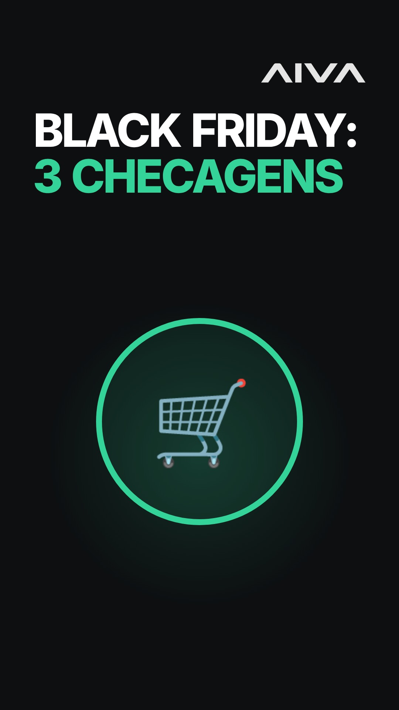
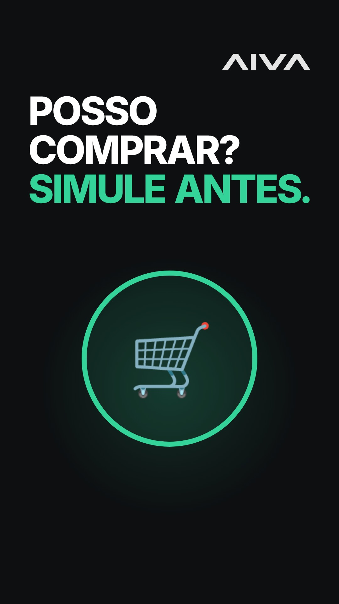
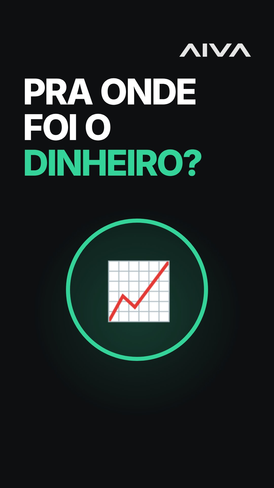

# Reels prontos que ainda não foram postados

Todos às **13h25 (Brasília)**, o horário do Reel mais assistido da conta. Todos têm voz sintética: marque **"Conteúdo gerado por IA"** ao postar. A música é escolhida no app do Instagram (sugestões abaixo de cada Reel).

Já postados: Reel 23 (16/11) e Reel 19 (16/11, 13h25).


---

## Reel 24 · O que o Copilot faz + cupom FUNDADOR

**Postar:** quarta, 18/11, 13h25  
**Gancho usado:** Existe um jeito ainda melhor


[▶ Ver/baixar o vídeo](https://github.com/Vinciuus22/aiva-midia/raw/claude/project-thread-ksvf5f/reels/prontos/aiva_reel24.mp4) · [baixar a capa](https://github.com/Vinciuus22/aiva-midia/raw/claude/project-thread-ksvf5f/reels/prontos/capas/capa_reel24.jpg)

**Legenda**

```
O que o Copilot da AIVA faz por você? 💬

🎙️ Você fala com a IA por texto ou áudio: "gastei 80 no mercado"
✍️ Ela cadastra o gasto pra você durante a conversa
📅 Mostra a previsão de quanto pode sobrar até o fim do mês
🔔 Avisa quando um gasto sai do padrão ou o saldo fica em risco

No Copilot: lançamentos sem limite, 20 mensagens por mês com a IA e até 5 metas.

Com o código FUNDADOR: R$ 14,99/mês nos 3 primeiros meses (de R$ 29,99). Só 100 vagas, até 30/11, na primeira assinatura.

aivafinance.tech (link na bio)

Ilustração com valores fictícios.

#AIVA #MembroFundador #FinançasPessoais #InteligênciaArtificial #ControleDeGastos
```

**Primeiro comentário:** Qual você usaria mais: anotar por áudio ou o aviso de gasto fora do padrão? 👇

<details><summary>Música sugerida</summary>

Música em alta sugerida: Blue Moon, Zara Larsson
Alternativa (sem letra, não briga com a voz): Autumn Colors, LuLuMusic (instrumental)
Por quê: Leve, não briga com a voz; bom para fim de semana.

No app: volume da música entre 10% e 15%, voz em 100%.
Se a música não aparecer (conta comercial tem biblioteca limitada), use a alternativa ou outra da aba "Em alta" do Instagram.

</details>


---

## Reel 22 · Black Friday: parcelas

**Postar:** sexta, 20/11, 13h25  
**Gancho usado:** Nada disso vale se você não fizer esta conta



[▶ Ver/baixar o vídeo](https://github.com/Vinciuus22/aiva-midia/raw/claude/project-thread-ksvf5f/reels/prontos/aiva_reel22.mp4) · [baixar a capa](https://github.com/Vinciuus22/aiva-midia/raw/claude/project-thread-ksvf5f/reels/prontos/capas/capa_reel22.jpg)

**Legenda**

```
10x cabe no mês? 💳

Cabe hoje. Mas ela volta nos próximos 9 meses, e soma com as parcelas que já existem.

Na AIVA, cada lançamento parcelado mostra em que parcela você está (1/10, 2/10…), e o Painel desconta as contas que ainda vencem no mês.

Antes de parcelar na Black Friday: some as parcelas do mês.
📌 Salva pra lembrar na hora da compra.

Quantas parcelas você tem rodando hoje? A, B ou C 👇

aivafinance.tech (link na bio)

Ilustração com valores fictícios.

#AIVA #BlackFriday #CompraParcelada #FinançasPessoais #OrganizaçãoFinanceira
```

**Primeiro comentário:** Somou as suas? Conta quantas são 👇

<details><summary>Música sugerida</summary>

Música em alta sugerida: Luminary, Joel Sunny (instrumental)
Alternativa (sem letra, não briga com a voz): Autumn Colors, LuLuMusic (instrumental)
Por quê: Instrumental dramático para "nenhuma promoção vale a pena".

No app: volume da música entre 10% e 15%, voz em 100%.
Se a música não aparecer (conta comercial tem biblioteca limitada), use a alternativa ou outra da aba "Em alta" do Instagram.

</details>


---

## Reel 25 · Oferta BLACKAIVA (só depois de 23/11)

**Postar:** terça, 24/11, 13h25  
**Gancho usado:** Resultado primeiro (R$ 35,99 no Premium)



[▶ Ver/baixar o vídeo](https://github.com/Vinciuus22/aiva-midia/raw/claude/project-thread-ksvf5f/reels/prontos/aiva_reel25.mp4) · [baixar a capa](https://github.com/Vinciuus22/aiva-midia/raw/claude/project-thread-ksvf5f/reels/prontos/capas/capa_reel25.jpg)

**Legenda**

```
A Black Friday da AIVA chegou. 🖤

Com o código BLACKAIVA, o Premium sai com 40% de desconto nos 3 primeiros meses: de R$ 59,99 por R$ 35,99/mês.

No Premium:
💬 Chat com a IA ilimitado
🛍️ Simulação de compras com os seus dados
🔁 Assinaturas esquecidas e desperdícios recorrentes
📊 Relatórios, importação de planilhas e exportação

Use o código BLACKAIVA na tela de pagamento.

Qual você usaria primeiro? Comenta A, B ou C 👇

aivafinance.tech (link na bio)

#AIVA #BlackFriday #FinançasPessoais #ControleFinanceiro #OrganizaçãoFinanceira
```

**Primeiro comentário:** A: chat ilimitado · B: simulação de compras · C: relatórios. Qual é a sua? 👇

<details><summary>Música sugerida</summary>

Música em alta sugerida: What You Waiting For?, Gwen Stefani
Alternativa (sem letra, não briga com a voz): Luminary, Joel Sunny (instrumental)
Por quê: O nome da música é o convite da oferta. Só a partir de 23/11.

No app: volume da música entre 10% e 15%, voz em 100%.
Se a música não aparecer (conta comercial tem biblioteca limitada), use a alternativa ou outra da aba "Em alta" do Instagram.

</details>


---

## Reel 21 · Black Friday: 3 checagens

**Postar:** quarta, 25/11, 13h25  
**Gancho usado:** Mito e desmentir (tudo é promoção? Falso)



[▶ Ver/baixar o vídeo](https://github.com/Vinciuus22/aiva-midia/raw/claude/project-thread-ksvf5f/reels/prontos/aiva_reel21.mp4) · [baixar a capa](https://github.com/Vinciuus22/aiva-midia/raw/claude/project-thread-ksvf5f/reels/prontos/capas/capa_reel21.jpg)

**Legenda**

```
Black Friday: tudo em promoção? 🛒

Antes do carrinho, 3 checagens rápidas:
1️⃣ Estava na sua lista?
2️⃣ Quantas parcelas já estão rodando?
3️⃣ Quanto dá até o fim do mês?

Na AIVA, metas, parcelas (1/10, 2/10…) e o disponível até o fim do mês ficam num lugar só.

Vai comprar na Black Friday? Comenta 1 (sim), 2 (não) ou 3 (só o que está na lista) 👇
📌 Salva pra conferir antes de comprar.

aivafinance.tech (link na bio)

Ilustração com valores fictícios.

#AIVA #BlackFriday #FinançasPessoais #ControleDeGastos #ComprasConscientes
```

**Primeiro comentário:** A gente vai de 3: só o que está na lista 😅 E você?

<details><summary>Música sugerida</summary>

Música em alta sugerida: Housewife, Tate McRae (1ª em alta na semana)
Alternativa (sem letra, não briga com a voz): Autumn Colors, LuLuMusic (instrumental)
Por quê: Áudio mais usado da semana; dois dias antes da Black Friday.

No app: volume da música entre 10% e 15%, voz em 100%.
Se a música não aparecer (conta comercial tem biblioteca limitada), use a alternativa ou outra da aba "Em alta" do Instagram.

</details>


---

## Reel 26 · Simule antes de comprar (BLACKAIVA)

**Postar:** quinta, 26/11, 13h25  
**Gancho usado:** Alternativa C (nem pensar duas vezes, nem pedir opinião)



[▶ Ver/baixar o vídeo](https://github.com/Vinciuus22/aiva-midia/raw/claude/project-thread-ksvf5f/reels/prontos/aiva_reel26.mp4) · [baixar a capa](https://github.com/Vinciuus22/aiva-midia/raw/claude/project-thread-ksvf5f/reels/prontos/capas/capa_reel26.jpg)

**Legenda**

```
Vai comprar alguma coisa na Black Friday? 🛒

No Premium da AIVA, você pergunta pra IA antes: "posso comprar um fone de R$ 400?"
Ela pega o seu saldo, desconta as contas que ainda vão vencer e o valor da compra, e mostra quanto sobra até o fim do mês, ou se o mês fica no vermelho.

Na Black Friday, o Premium sai com 40% de desconto nos 3 primeiros meses com o código BLACKAIVA (de R$ 59,99 por R$ 35,99/mês).

📌 Salva pra simular antes do carrinho.

O que você simularia primeiro? Conta aqui 👇

aivafinance.tech (link na bio)

Ilustração com valores fictícios.

#AIVA #BlackFriday #ComprasConscientes #FinançasPessoais #ControleDeGastos
```

**Primeiro comentário:** Celular, TV, fone ou passagem? O que vai pra simulação? 👇

<details><summary>Música sugerida</summary>

Música em alta sugerida: Autumn Colors, LuLuMusic (instrumental)
Alternativa (sem letra, não briga com a voz): Luminary, Joel Sunny (instrumental)
Por quê: Véspera da Black Friday; calmo, deixa a conta em primeiro plano.

No app: volume da música entre 10% e 15%, voz em 100%.
Se a música não aparecer (conta comercial tem biblioteca limitada), use a alternativa ou outra da aba "Em alta" do Instagram.

</details>


---

## Reel 20 · Relatórios

**Postar:** sábado, 28/11, 13h25  
**Gancho usado:** Alternativa C (nem extrato, nem planilha)



[▶ Ver/baixar o vídeo](https://github.com/Vinciuus22/aiva-midia/raw/claude/project-thread-ksvf5f/reels/prontos/aiva_reel20.mp4) · [baixar a capa](https://github.com/Vinciuus22/aiva-midia/raw/claude/project-thread-ksvf5f/reels/prontos/capas/capa_reel20.jpg)

**Legenda**

```
Pra onde foi o dinheiro? 📈

Nos Relatórios da AIVA:
🍩 Quanto cada categoria pesa no mês
⚡ Leituras automáticas: ritmo de gasto, categoria que mais pesa e se o mês está no verde
📊 Comparação com o período anterior

Qual categoria você acha que mais pesa no seu mês? Conta aqui 👇

aivafinance.tech (link na bio)

Ilustração com valores fictícios. Relatórios disponíveis no plano Premium.

#AIVA #FinançasPessoais #ControleDeGastos #OrganizaçãoFinanceira #EducaçãoFinanceira
```

**Primeiro comentário:** Aposta: moradia, mercado ou delivery? 👇

<details><summary>Música sugerida</summary>

Música em alta sugerida: Pump It, The Black Eyed Peas
Alternativa (sem letra, não briga com a voz): Luminary, Joel Sunny (instrumental)
Por quê: Usada em vídeos com rótulos na tela, como as categorias.

No app: volume da música entre 10% e 15%, voz em 100%.
Se a música não aparecer (conta comercial tem biblioteca limitada), use a alternativa ou outra da aba "Em alta" do Instagram.

</details>
